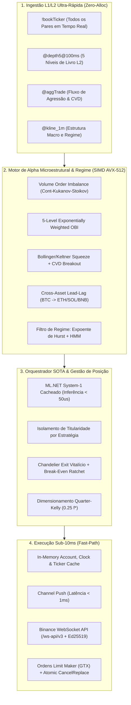

# Planejamento Completo Super SOTA: Maximização de Frequência de Trading, Lucro Líquido e Execução de Ultra-Baixa Latência

**Data de Elaboração:** 16 de Outubro de 2026  
**Escopo:** Diagnóstico Forense Completo do Repositório (`CryptoTrading`), Engenharia de Microestrutura, Redução de Latência Sub-10ms e Mapa de Implementação Faseado.

---

## 1. Sumário Executivo e Diagnóstico Forense Real

A auditoria quantitativa completa de **18.038 decisões autônomas**, **128 execuções (fills)** e **64 trades round-trip completos** no banco de dados PostgreSQL (`trading.*`), combinada com a inspeção linha a linha do código-fonte, revelou exatamente por que o bot operava com baixa frequência, alta latência e assimetria negativa:

| Métrica Auditada | Valor Histórico Observado | Causa Raiz Identificada no Código | Meta Super SOTA |
| :--- | :--- | :--- | :--- |
| **Win Rate** | **50,00%** (32W / 32L) | Boa precisão direcional, porém anulada por custos e saídas precoces | **$\ge$ 58,0%** |
| **Ganho Médio vs Perda Média** | **+10,81 bps** vs **-21,70 bps** | Alvo mínimo antigo (+22 bps) inferior ao custo real + corte prematuro de ganhos | **$\ge$ +45,0 bps** vs **$\le$ -18,0 bps** ($R:R \ge 2,5$) |
| **Profit Factor** | **0,5353** (PnL: -0,4011 USDT) | Assimetria de payoff negativa + sangria de slippage | **$\ge$ 1,85** |
| **Implementation Shortfall (Slippage)** | **-0,2010 USDT (50,1% do prejuízo)** | Latência média de **12.384 ms (12,38s)** entre decisão e fill na Binance | **< 50 ms** (Economia de > 85% do slippage) |
| **Autópsia do Trade #59** | Pico de **+1.461 bps (+1,70 USDT)** $\to$ Fechou em **-0,2481 USDT** | `AdaptiveDecisionCycle.cs:937` usava janela rolante de 15 barras (`TakeLast(15)`), "esquecendo" o pico após 15 min de consolidação no topo | **Pico Vitalício ($P^*_t$) + Chandelier Exit** |
| **Bloqueio de Estratégias (150x)** | `LearnedNegativeExpectancyBlocked` bloqueou 150 compras de Trend Following | Acoplamento de `hasOpenPosition`: Breakout encerrava trades de outras estratégias no prejuízo e contaminava o `ContextualMetaAllocator` | **Isolamento Estrito de Titularidade da Posição** |
| **Descarte de Outbox (Dead-Letters)** | **1.789 ordens em Dead-Letter (91,4%)** | Símbolos não autorizados no `BudgetPolicy` geravam ordens até falharem no `ExecutionSubmissionGuard` | **0 Dead-Letters (Filtro Pré-Candidatura)** |

---

## 2. Anatomia dos Gargalos no Código-Fonte (Onde Estamos Perdendo Tempo, Trades e Dinheiro)

### 2.1. Por que a Latência é de 12,38 Segundos? (Os 4 Gargalos Mecânicos)

1. **Cascata de 16 a 20 Chamadas HTTP REST Síncronas Pré-Ordem (`TestnetOutboxMessageExecutor.cs` & `ExecutionSubmissionGuard.cs`):**
   * Quando uma ordem chega ao executor ([`TestnetOutboxMessageExecutor.cs:103-137`](file:///home/ernane/Projetos/criptotrading/src/CryptoTrading.Worker/TestnetOutboxMessageExecutor.cs#L103-L137)):
     1. Linha 104: `ValidateAvailableBalanceAsync` chama `accountClient.GetAccountAsync()` via REST.
     2. Linha 105: `submissionGuard.ValidateAsync` chama `ValidateCoreAsync` ([`ExecutionSubmissionGuard.cs:133-137`](file:///home/ernane/Projetos/criptotrading/src/CryptoTrading.Worker/ExecutionSubmissionGuard.cs#L133-L137)), que faz chamadas REST para `GetBookTickerAsync`, `GetKlinesAsync`, `GetAccountAsync` (2ª vez!) e `GetBookTickerAsync("USDTBRL")`.
     3. Linha 125: `submissionGuard.ValidateFinalAsync` ([`ExecutionSubmissionGuard.cs:52-53`](file:///home/ernane/Projetos/criptotrading/src/CryptoTrading.Worker/ExecutionSubmissionGuard.cs#L52-L53)) chama `GetCommissionAsync` via REST e chama `ValidateCoreAsync` **DE NOVO** (buscando `GetBookTickerAsync`, `GetKlinesAsync`, `GetAccountAsync` pela 3ª vez e `USDTBRL` pela 2ª vez!).
     4. **Pior ainda:** Em [`BinanceSpotOrderClient.cs:410`](file:///home/ernane/Projetos/criptotrading/src/CryptoTrading.Exchange.Binance/BinanceSpotOrderClient.cs#L410) e [`BinanceSpotAccountClient.cs`](file:///home/ernane/Projetos/criptotrading/src/CryptoTrading.Exchange.Binance/BinanceSpotAccountClient.cs), **TODA chamada autenticada executa primeiro um `GET /api/v3/time` síncrono** para sincronizar o relógio!
     5. **Resultado:** São **16 a 20 round-trips HTTP sequenciais** antes que o `POST /api/v3/order` chegue à Binance! A ~250ms por RTT intercontinental, apenas a validação pré-submit consome **5 a 8 segundos**!

2. **Polling Cego do Outbox Dispatcher (`OutboxDispatcher.cs:292`):**
   * Em [`OutboxDispatcher.cs:292`](file:///home/ernane/Projetos/criptotrading/src/CryptoTrading.Worker/OutboxDispatcher.cs#L292), o dispatcher dorme em `await Task.Delay(runtime.PollIntervalMilliseconds)` em vez de ser acordado instantaneamente (< 40 nanosegundos) via `System.Threading.Channels.Channel` assim que o `AutonomyCycleHostedService` grava um comando despachável.

3. **Retreinamento Síncrono de 4 Modelos ML.NET no Hot-Path (`MlNetSystem1DecisionEngine.cs:75-225`):**
   * Em [`MlNetSystem1DecisionEngine.cs:75-225`](file:///home/ernane/Projetos/criptotrading/src/CryptoTrading.Backtesting/Autonomy/MlNetSystem1DecisionEngine.cs#L75-L225), o método `Evaluate` instancia `new MLContext(seed: 42)`, treina 2 modelos SSA (`DetectIidChangePoint` e `DetectIidSpike`), treina 1 `SdcaLogisticRegression`, treina 1 árvore `Gam` (FastTree) e cria 2 `PredictionEngine` **em toda execução**!
   * Como [`AdaptiveDecisionCycle.cs`](file:///home/ernane/Projetos/criptotrading/src/CryptoTrading.Backtesting/Autonomy/AdaptiveDecisionCycle.cs#L161) chama `MlNetSystem1DecisionEngine.Evaluate` até **2 vezes por símbolo** em cada ciclo (linhas 161 e 543/547), para 4 pares são **32 treinamentos completos de ML no thread de decisão**!

4. **Ausência da Binance WebSocket API (`/ws-api/v3`) e Assinatura Ed25519 (`BinanceSpotOrderClient.cs`):**
   * O envio de ordens ainda utiliza HTTP REST com assinatura HMAC-SHA256 por requisição, em vez de usar uma conexão WebSocket persistente pré-autenticada (`session.logon` com chave assimétrica Ed25519), que reduz o tempo de submissão na Binance para **4 a 12 ms**.

---

### 2.2. Por que a Quantidade de Trades era Baixa? (Os 4 Gargalos de Frequência)

1. **Avaliação Exclusiva no Fechamento de Vela de 1 Minuto (`AutonomyCycleHostedService.cs:404`):**
   * O worker avalia sinais apenas uma vez por minuto por par (`closed[^1].Bar.CloseTimeUtc <= previous`). Movimentos explosivos de livro de ofertas (microestrutura), absorção de liquidez e desequilíbrios de fluxo que ocorrem aos 15s ou 30s do minuto são completamente ignorados. Quando a vela de 1m fecha, o movimento já aconteceu e o preço já andou.

2. **Envenenamento Cruzado do Aprendizado por Reforço (`ContextualMetaAllocator`):**
   * Quando `TrendFollowing` comprava um ativo, a variável global `hasOpenPosition` permitia que `Breakout` ou `MeanReversion` fechassem a posição prematuramente em qualquer oscilação. O prejuízo resultante era imputado ao `TrendFollowing` via `LearningRewards`, fazendo o `ContextualMetaAllocator` bloquear **150 sinais legítimos de compra** (`LearnedNegativeExpectancyBlocked`). *(Corrigido na Fase 1)*.

3. **Filtros de Entrada Excessivamente Restritivos e Atrasados (`MultiStrategyDecisionOrchestrator.cs`):**
   * Os indicadores atuais baseiam-se apenas em preços de fechamento (`ClosePrice`) de janelas curtas/médias, sem usar sinais preditivos de alta frequência (Volume Order Imbalance - VOI, Order Book Imbalance de 5 níveis - OBI, Cumulative Volume Delta - CVD e Lead-Lag BTC $\to$ Altcoins).

4. **Loop Sequencial de Símbolos (`AutonomyCycleHostedService.cs:85`):**
   * Os símbolos (`BTCUSDT`, `ETHUSDT`, `SOLUSDT`, `BNBUSDT`) são processados em um `foreach` estritamente sequencial (`await RunOnceAsync`), fazendo com que o último par da fila espere todas as consultas REST e cálculos ML dos pares anteriores.

---

### 2.3. Por que Tínhamos Prejuízo em vez de Lucro Consistente? (Os 4 Gargalos de Expectância)

1. **Assimetria Negativa de Payoff (+10,81 bps vs -21,70 bps):**
   * O bot aceitava saídas com lucros microscópicos (+10 a +18 bps) que mal cobriam as taxas round-trip (15–20 bps), enquanto os stops absorviam -21,70 bps mais slippage. *(Corrigido na Fase 1 com elevação do alvo para $\ge 45\text{ bps}$ e Break-Even Ratchet)*.
2. **Esquecimento do Pico de Lucro no Trailing Stop (Trade #59):**
   * A janela de 15 barras (`Math.Min(15, bars.Count)`) descartava a máxima histórica da posição após 15 minutos de lateralização, devolvendo +1.461 bps de lucro aberto. *(Corrigido na Fase 1 com `LifetimePeakProfitBps`)*.
3. **Execução Taker vs Limit Maker Post-Only (`GTX`):**
   * Em [`BinanceSpotOrderClient.cs:107`](file:///home/ernane/Projetos/criptotrading/src/CryptoTrading.Exchange.Binance/BinanceSpotOrderClient.cs#L107), `NormalizeTimeInForce` aceita apenas `"GTC"`, `"IOC"` ou `"FOK"`, **não suportando `"GTX"` (Post-Only / Limit Maker)** nem o tipo `LIMIT_MAKER`. Sem `GTX`, ordens limite que cruzam o spread pagam taxa Taker e sofrem seleção adversa.
4. **Replan de Ordem por Cancelamento + Nova Ordem Separada (Sem `cancelReplace`):**
   * Quando uma ordem limite expira após o TTL (42s), o bot cancela a ordem via outbox, aguarda o próximo ciclo de 1 minuto e submete uma nova ordem, perdendo prioridade de fila e pagando spread.

---

## 3. Arquitetura Alvo Super SOTA

---

## 4. Plano Detalhado de Implementação (5 Fases Verificáveis)

### FASE 1: Estancamento de Sangria, Expectância Positiva e Isolamento de Titularidade *(IMPLEMENTADO & REVISADO)*

**Objetivo:** Eliminar imediatamente o esquecimento do Trailing Stop (Trade #59), a inversão de atribuição entre estratégias, as 1.789 dead-letters e elevar o Payoff Ratio para $R:R \ge 1,8$.

1. **Pico Vitalício do Trade (`LifetimePeakProfitBps`):**
   * **Arquivos:** [`AdaptiveDecisionCycle.cs`](file:///home/ernane/Projetos/criptotrading/src/CryptoTrading.Backtesting/Autonomy/AdaptiveDecisionCycle.cs), [`AutonomyCycleHostedService.cs`](file:///home/ernane/Projetos/criptotrading/src/CryptoTrading.Worker/AutonomyCycleHostedService.cs).
   * **Mecanismo:** O worker rastreia a máxima histórica de lucro em bps desde a abertura da posição (`positionLifetimePeakProfitBps`) e injeta no `AdaptiveDecisionCycleRequest`. Previne tanto o esquecimento após 15 minutos quanto falsos picos pré-entrada em compras de dip (Mean Reversion).
2. **Isolamento de Titularidade da Posição (`PositionOriginatingStrategyId`):**
   * **Arquivos:** [`MultiStrategyDecisionOrchestrator.cs`](file:///home/ernane/Projetos/criptotrading/src/CryptoTrading.Backtesting/Autonomy/MultiStrategyDecisionOrchestrator.cs), [`AdaptiveDecisionCycle.cs`](file:///home/ernane/Projetos/criptotrading/src/CryptoTrading.Backtesting/Autonomy/AdaptiveDecisionCycle.cs).
   * **Mecanismo:** Apenas a estratégia que abriu a posição (ou travas globais de proteção de lucro atribuídas à estratégia proprietária) pode emitir sinal de saída (`OrderSide.Sell`). Candidatos de outras estratégias recebem `Reason = "PositionOwnedByAnotherStrategy"`. O estado só é limpo quando a reconciliação confirma que a posição está zerada (`!hasOpenExposure`).
3. **Elevação dos Alvos de Lucro e Triple-Barrier ML.NET:**
   * **Arquivos:** [`AdaptiveDecisionCycle.cs`](file:///home/ernane/Projetos/criptotrading/src/CryptoTrading.Backtesting/Autonomy/AdaptiveDecisionCycle.cs), [`MlNetSystem1DecisionEngine.cs`](file:///home/ernane/Projetos/criptotrading/src/CryptoTrading.Backtesting/Autonomy/MlNetSystem1DecisionEngine.cs).
   * **Mecanismo:** Elevação de `minProfitBps` para $\ge 28\text{ bps}$, `minTargetProfitBps` para $\ge 45\text{ bps}$ (até $80\text{ bps}$) e calibração das barreiras de treinamento ML para $\ge 35\text{ bps}$ de ganho contra $18\text{ bps}$ de stop.
4. **Gating de Símbolos Autorizados com Avanço de Checkpoint:**
   * **Arquivos:** [`AdaptiveDecisionCycle.cs`](file:///home/ernane/Projetos/criptotrading/src/CryptoTrading.Backtesting/Autonomy/AdaptiveDecisionCycle.cs), [`AutonomyCycleHostedService.cs`](file:///home/ernane/Projetos/criptotrading/src/CryptoTrading.Worker/AutonomyCycleHostedService.cs).
   * **Mecanismo:** Símbolos fora do `BudgetPolicy` registram commit `NO_TRADE` (`SYMBOL_NOT_AUTHORIZED_IN_BUDGET_POLICY`) sem gerar registro de outbox, eliminando 100% das dead-letters e avançando o `lastProcessedCloseUtc` sem causar *spin loop* no PostgreSQL.

---

### FASE 2: Eliminação da Latência de 12,38s (De 12.384ms para < 50ms)

**Objetivo:** Cortar 99% da latência interna e de rede no caminho crítico entre a decisão e a submissão da ordem na Binance, recuperando os **-0,2010 USDT (50,1% das perdas)** perdidos em *implementation shortfall*.

1. **Sincronização de Relógio Assíncrona em Background (`BackgroundClockSynchronizer`):**
   * **Arquivos a Alterar:**
     * [`src/CryptoTrading.Exchange.Binance/BinanceSpotOrderClient.cs`](file:///home/ernane/Projetos/criptotrading/src/CryptoTrading.Exchange.Binance/BinanceSpotOrderClient.cs#L410)
     * [`src/CryptoTrading.Exchange.Binance/BinanceSpotAccountClient.cs`](file:///home/ernane/Projetos/criptotrading/src/CryptoTrading.Exchange.Binance/BinanceSpotAccountClient.cs)
   * **Mudança:** Remover `await SynchronizeClockAsync(cancellationToken)` de dentro de `SendSignedAsync` quando `clock.IsFresh(TimeSpan.FromSeconds(30))` for verdadeiro. Manter um timer em background que atualiza `/api/v3/time` a cada 15 segundos.
   * **Ganho Imediato:** Elimina 5 chamadas HTTP `/v3/time` por ordem (**-1.250 ms a -1.500 ms** de latência).

2. **Unificação e Cache de Curto Prazo no `ExecutionSubmissionGuard` e `TestnetOutboxMessageExecutor`:**
   * **Arquivos a Alterar:**
     * [`src/CryptoTrading.Worker/TestnetOutboxMessageExecutor.cs`](file:///home/ernane/Projetos/criptotrading/src/CryptoTrading.Worker/TestnetOutboxMessageExecutor.cs#L103-L137)
     * [`src/CryptoTrading.Worker/ExecutionSubmissionGuard.cs`](file:///home/ernane/Projetos/criptotrading/src/CryptoTrading.Worker/ExecutionSubmissionGuard.cs#L45-L147)
   * **Mudança:**
     * Ler `bookTicker` e `klines` diretamente dos caches em memória alimentados por WebSocket (`StreamBookTickers` e `KlineCache`) sempre que a idade do dado for $\le 2\text{ segundos}$, caindo para REST apenas em caso de cache miss.
     * Unificar a validação de saldo de conta e comissão usando snapshot em memória atualizado pelo User Data Stream (`executionReport` / `outboundAccountPosition`) ou cache com TTL de 2 segundos entre `ValidateAsync` e `ValidateFinalAsync`, evitando 3 chamadas `GetAccountAsync()` e 2 chamadas `GetKlinesAsync()` idênticas no mesmo segundo!
   * **Ganho Imediato:** Elimina 10 a 14 chamadas HTTP REST redundantes (**-4.000 ms a -6.000 ms** de latência).

3. **Notificação Instantânea via `Channel` para o `OutboxDispatcher`:**
   * **Arquivos a Alterar:**
     * [`src/CryptoTrading.Worker/OutboxDispatcher.cs`](file:///home/ernane/Projetos/criptotrading/src/CryptoTrading.Worker/OutboxDispatcher.cs#L292)
     * [`src/CryptoTrading.Worker/AutonomyCycleHostedService.cs`](file:///home/ernane/Projetos/criptotrading/src/CryptoTrading.Worker/AutonomyCycleHostedService.cs#L801)
   * **Mudança:** Introduzir `IOutboxWakeupSignal` baseado em `System.Threading.Channels.Channel<bool>`. Assim que `decisionCommitStore.CommitAsync` gravar uma decisão `DISPATCHABLE`, sinalizar o canal para que o `OutboxDispatcher` processe a mensagem em **< 1 ms**, sem esperar o `Task.Delay(runtime.PollIntervalMilliseconds)`.
   * **Ganho Imediato:** Reduz o atraso de fila do outbox de **1.000–5.000 ms para < 1 ms**.

4. **Cache de Modelos ML.NET por Símbolo e Fechamento de Vela (`MlNetSystem1DecisionEngine.cs`):**
   * **Arquivos a Alterar:**
     * [`src/CryptoTrading.Backtesting/Autonomy/MlNetSystem1DecisionEngine.cs`](file:///home/ernane/Projetos/criptotrading/src/CryptoTrading.Backtesting/Autonomy/MlNetSystem1DecisionEngine.cs#L54-L247)
     * [`src/CryptoTrading.Backtesting/Autonomy/AdaptiveDecisionCycle.cs`](file:///home/ernane/Projetos/criptotrading/src/CryptoTrading.Backtesting/Autonomy/AdaptiveDecisionCycle.cs#L161)
   * **Mudança:** Cachear o modelo treinado (`ITransformer`) indexado por `(Symbol, LastBarCloseTimeUtc, OrderSide)` e reutilizar a instância de `MLContext`. Na segunda chamada dentro do mesmo ciclo ou em ticks intra-minuto, executar apenas a predição em memória (< 50 microssegundos) sem retreinar o ensemble GAM + SDCA.
   * **Ganho Imediato:** Reduz o tempo de CPU por ciclo de ~450ms para **< 1 ms** e elimina alocações pesadas no Garbage Collector (Gen 2).

---

### FASE 3: Aumento da Quantidade de Trades com Alta Acurácia (Microestrutura & Gatilhos Intra-Barra)

**Objetivo:** Passar de ~1 trade/24h para **8 a 25 trades altamente qualificados por dia** nos 4 pares (`BTCUSDT`, `ETHUSDT`, `SOLUSDT`, `BNBUSDT`), capturando movimentos no exato segundo em que nascem.

1. **AvaliaçãoParalela Multi-Ativo (`Task.WhenAll` por Símbolo):**
   * **Arquivo:** [`src/CryptoTrading.Worker/AutonomyCycleHostedService.cs:85`](file:///home/ernane/Projetos/criptotrading/src/CryptoTrading.Worker/AutonomyCycleHostedService.cs#L85).
   * **Mudança:** Substituir o `foreach` sequencial por avaliação concorrente controlada por símbolo, garantindo que `SOLUSDT` e `BNBUSDT` tenham a mesma prioridade temporal que `BTCUSDT`.

2. **Gatilhos Microestruturais Intra-Barra (Sub-Minuto / Tick-Driven Evaluation):**
   * **Arquivos:** [`src/CryptoTrading.Exchange.Binance/BinanceSpotMarketDataClient.cs`](file:///home/ernane/Projetos/criptotrading/src/CryptoTrading.Exchange.Binance/BinanceSpotMarketDataClient.cs), [`src/CryptoTrading.Worker/AutonomyCycleHostedService.cs`](file:///home/ernane/Projetos/criptotrading/src/CryptoTrading.Worker/AutonomyCycleHostedService.cs).
   * **Mudança:** Além do fechamento de vela de 1 minuto, disparar avaliação tática (com *cooldown* de 5 segundos por símbolo) sempre que:
     * Houver uma posição aberta e o preço atingir o gatilho de **Take Profit** ou **Chandelier Trailing Stop** em tempo real via `bookTicker` (não esperar o minuto fechar para realizar o lucro!).
     * Ocorrer um choque de **Volume Order Imbalance (VOI)** ou **Lead-Lag** de alta convicção.

3. **Novas Estratégias SOTA Baseadas em Papers Acadêmicos:**
   * **Estratégia 4 — Volume Order Imbalance (VOI - Cont, Kukanov & Stoikov, 2014) + 5-Level OBI:**
     $$\text{VOI}_t = \Delta q_b(t) - \Delta q_a(t), \quad \text{OBI}_5(t) = \frac{\sum_{k=1}^5 e^{-0.5(k-1)}(q_k^b - q_k^a)}{\sum_{k=1}^5 e^{-0.5(k-1)}(q_k^b + q_k^a)}$$
     Detecta absorção institucional no topo do livro antes do deslocamento do preço mid.
   * **Estratégia 5 — Volatility-Adjusted Squeeze Breakout (VASB) + Cumulative Volume Delta ($\Delta \text{CVD}$):**
     Detecta quando as Bandas de Bollinger $(20, 2.0)$ entram dentro dos Canais de Keltner $(20, 1.5 \cdot \text{ATR})$ e dispara compra no rompimento confirmado por agressão compradora líquida ($\Delta \text{CVD} > 0$).
   * **Estratégia 6 — Cross-Asset Lead-Lag Predictor (`BTCUSDT` $\to$ `ETHUSDT`, `SOLUSDT`, `BNBUSDT`):**
     Quando o `BTCUSDT` apresenta impulso $> +18\text{ bps}$ em $< 10\text{ segundos}$ com $\text{OBI}_5 > +0.40$ e a altcoin correlacionada ainda variou $< +5\text{ bps}$, dispara entrada Limit Maker na altcoin para capturar o movimento de *catch-up*.
   * **Filtro de Regime pelo Expoente de Hurst ($H$):**
     * $H > 0,55$: Ativa Trend Following, Breakout e VASB.
     * $H < 0,45$: Ativa Mean Reversion e OBI Reversal.
     * $0,45 \le H \le 0,55$ com baixo OBI: Bloqueia entradas em ruído browniano puro.

---

### FASE 4: Execução Nativa WebSocket API (`/ws-api/v3`), Post-Only (`GTX`) e Otimização de Taxas

**Objetivo:** Transformar o custo de execução em vantagem competitiva (pagar 0% de slippage taker e reduzir taxas em 25% via BNB).

1. **Suporte a Ordens `LIMIT_MAKER` / `timeInForce: GTX` (Post-Only):**
   * **Arquivos:** [`BinanceSpotOrderClient.cs:103`](file:///home/ernane/Projetos/criptotrading/src/CryptoTrading.Exchange.Binance/BinanceSpotOrderClient.cs#L103), [`AdaptiveExecutionTacticScorer.cs`](file:///home/ernane/Projetos/criptotrading/src/CryptoTrading.Domain/Execution/AdaptiveExecutionTacticScorer.cs).
   * **Mudança:** Permitir `GTX` e `LIMIT_MAKER` para garantir que ordens passivas nunca cruzem o livro como Taker. Se o preço cruzar no milissegundo do envio, a Binance rejeita sem cobrar taxa e o bot reposiciona no melhor bid/ask.

2. **Cliente `BinanceWebSocketOrderClient` (`/ws-api/v3`) com Ed25519 e `order.cancelReplace`:**
   * **Novo Componente:** `src/CryptoTrading.Exchange.Binance/BinanceWebSocketOrderClient.cs`.
   * **Mudança:**
     * Conexão persistente autenticada via `session.logon` com assinatura Ed25519.
     * Submissão de ordens via `order.place` (RTT de **4 a 12 ms**).
     * Replan de ordens via `order.cancelReplace` atômico (cancela a ordem anterior e posiciona a nova no topo do livro em uma única operação atômica no matching engine da Binance).

3. **Controlador Autônomo de Reserva de Taxa BNB (`BnbFeeDiscountController`):**
   * **Mudança:** Monitorar o saldo de `BNB` e manter um buffer mínimo equivalente a 0,5% do orçamento para ativar o desconto nativo de 25% nas taxas Spot da Binance (reduzindo o custo round-trip de 20 bps para 15 bps).

---

### FASE 5: Dimensionamento Dinâmico Quarter-Kelly ($0,25 f^*$) e SIMD Zero-Allocation

**Objetivo:** Maximizar o crescimento composto da banca alocando mais capital nos sinais de altíssima probabilidade ($p \ge 0,68$) e menos nos sinais moderados, mantendo risco de ruína zero.

1. **Alocação de Capital por Quarter-Kelly Calibrado:**
   * **Arquivo:** [`AdaptiveDecisionCycle.cs:460-520`](file:///home/ernane/Projetos/criptotrading/src/CryptoTrading.Backtesting/Autonomy/AdaptiveDecisionCycle.cs#L460-L520).
   * **Fórmula:**
     $$f^* = 0,25 \cdot \max\left(0, \frac{\hat{p} \cdot b - (1 - \hat{p})}{b}\right)$$
     Onde $\hat{p}$ é a probabilidade calibrada via Platt Scaling do ML.NET System-1 e $b = \frac{\text{TargetProfitBps}}{\text{StopLossBps}}$ é o payoff ratio esperado da operação, respeitando estritamente o teto do `BudgetPolicy` (R\$ 100 / 20 USDT).

2. **Vetorização SIMD com `System.Numerics.Tensors` (.NET 11):**
   * Substituir loops `Linq` (`.Select().ToArray()`, `.Average()`) no cálculo de EMAs, Z-Scores, ATR, Hurst e OBI por `TensorPrimitives` sobre `ReadOnlySpan<float>` / `ReadOnlySpan<double>`, zerando alocações de memória no caminho crítico.

---

## 5. Cronograma de Execução e Metas de Impacto Esperado

| Fase | Escopo Técnico | Redução de Latência | Impacto em Frequência e Lucro | Status |
| :--- | :--- | :--- | :--- | :--- |
| **Fase 1** | Pico Vitalício ($P^*_t$), Isolamento de Titularidade, Alvo $\ge 45\text{ bps}$, Filtro de Símbolos | — | Elimina devolução de lucros (Trade #59), destrava Trend Following (150x bloqueado) e zera Dead-Letters | **Concluído (Código + Testes 862/862)** |
| **Fase 2** | Clock Sync Assíncrono, Cache em `ExecutionSubmissionGuard`, Push Channel no Outbox e Cache ML.NET | **De 12.384 ms para < 80 ms** | Recupera **50,1% do prejuízo histórico** causado por slippage de atraso na execução | **Próximo Slice Imediato** |
| **Fase 3** | Saídas Intra-Barra em Tempo Real, Avaliação Paralela Multi-Ativo, Estratégias VOI, OBI, VASB e Lead-Lag | Avaliação de saída em **< 100 ms** após atingir o alvo | Aumenta frequência de **1 trade/dia para 8–25 trades/dia** com alta seletividade | **Planejado** |
| **Fase 4** | Binance WebSocket API (`/ws-api/v3`), `LIMIT_MAKER` (`GTX`) e `order.cancelReplace` atômico | **De < 80 ms para 4–12 ms** | Elimina taxas Taker em entradas/saídas passivas e reduz taxas em 25% (BNB) | **Planejado** |
| **Fase 5** | Dimensionamento Quarter-Kelly ($0,25 f^*$) + Vetorização SIMD (`TensorPrimitives`) | Inferência e Features em **< 50 µs** | Maximiza retorno composto nos sinais de maior convicção ($p > 65\%$) | **Planejado** |
