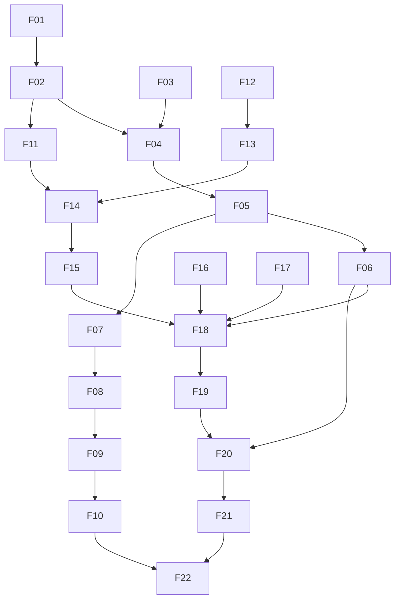

# Plano de finalização — 2026-10-11

## Estado e escopo

Base inspecionada: `c891d08131c318e35f8a688105434518c8e6e282`.
O checkout estava limpo ao iniciar esta etapa. Resultados anteriores em árvores
modificadas não certificam este SHA nem futuras alterações.

**Decisão atual: NO-GO Live.** O runtime suporta PAPER/TESTNET; Live não é uma
capability executável. R$100 é teto agregado informado pelo operador, não uma
autorização de ordem, nem uma política completa de perdas ou exposição.

Objetivo: fechar lacunas locais de integridade, segurança, operação e pesquisa;
produzir uma release candidata verificável. Não inclui envio de ordens, acesso
a segredos, deploy, publicação ou aprovação humana por inferência.

Três marcos separados:

1. **M1 — laboratório reproduzível:** build, testes, persistência e pesquisa offline.
2. **M2 — operação Shadow/PAPER:** dados reais read-only, recuperação e monitoramento.
3. **M3 — piloto financeiro:** capability de execução segregada, política aprovada,
   integração autorizada e GO humano vinculado ao artefato.

M1 não implica M2; M2 não autoriza M3. Testnet valida integração, não lucro Live.

## Convenções de esforço

Estimativas em pessoa-dias de engenharia (6–8 horas produtivas), incluindo testes
e revisão, não promessas de duração. Faixas dependem dos resultados de integração.
Paralelismo reduz espera de análises, não elimina dependências financeiras.
O integrador é o único escritor do código. Luna analisa escopos delimitados;
Terra propõe contratos/implementação; Sol revisa concorrência e risco financeiro.

## Backlog ordenado e critérios de aceite

| ID / prioridade | Trabalho e aceite | Depende de | Risco principal | Esforço |
|---|---|---|---|---|
| F01 / P0 | Revalidar precisão temporal dos eventos; teste determinístico de replay após restart com ticks submicrosegundo, identidade conflitante rejeitada e JSON/hash preservados | baseline | falso conflito de idempotência ou alteração de evidência | 0,5–1 dia |
| F02 / P1 | Harness PostgreSQL isolado; nomes únicos, sem credenciais externas, cleanup apenas de recursos próprios, volumes existentes preservados; migrations/integridade/lifecycle reais passam | F01, Docker local | apagar dados ou deixar recursos órfãos | 0,5–1 dia |
| F03 / P0 | Especificar budget por conta, moeda e autoridade; teto R$100 separado de sizing/autonomia; cotação validada, fees e reservas explicitadas | definição de política | confundir 100 USDT com R$100 | 1–2 dias |
| F04 / P0 | Reserva transacional de capital por intent; posições + pending + UNKNOWN + nova ordem; fencing multi-worker e idempotência | F02,F03 | duas ordens ultrapassarem orçamento por corrida | 3–5 dias |
| F05 / P0 | Conectar reservas a fills/cancel/rejeição/restart; não liberar UNKNOWN por timeout; reconciliação free/locked por ativo e ordem | F04 | saldo disponível fictício e exposição dupla | 3–5 dias |
| F06 / P0 | Guard de submissão e startup exige política íntegra/valoração fresca; rejeita exceder teto agregado, mesmo com sizing alterado | F04,F05 | bypass entre decisão e envio | 1–2 dias |
| F07 / P1 | Feedback de fills no estado das estratégias; rejeição/partial fill não altera inventário como execução completa; teste de recuperação | F05 ou modelo isolado de research | sinais gerados sobre posição inexistente | 3–7 dias |
| F08 / P1 | Modelo de execução research conservador com dados mais finos/OHLC, filtros step/tick/notional e cenários de latência/partial/rejeição | F07, dados adequados | fill em preço não executável | 3–7 dias |
| F09 / P1 | Custos documentados, spread/slippage variáveis, turnover e capacidade; excluir candidato inválido para orçamento | F08, fee tier redigida | edge desaparecer após custos | 2–5 dias |
| F10 / P1 | Protocolo de pesquisa fixado antes de holdout; universo point-in-time, exclusões/delistings e seleção rastreável; holdout intocado | F08,F09, dados históricos | overfitting/survivorship | 4–12 dias + calendário |
| F11 / P1 | Probes API/Worker/Web; liveness separado de readiness financeira; cenários healthy/degraded/restart com NO_TRADE | F02 | probe verde apesar de dependência financeira indisponível | 1–3 dias |
| F12 / P1 | PostgreSQL via secret/file sem senha em environment/argv/logs; redaction e permissões, sem ler valores reais | desenho compatível de configuração | vazamento via inspect/logs | 1–2 dias |
| F13 / P0 | Backup/restore isolado com contagens/hashes, corrupção detectada; agendamento observável, criptografia, retenção, RPO/RTO medidos | F02,F12, política operacional | perda de ledger ou falsa prova de restore | 3–5 dias + ciclo agendado |
| F14 / P1 | Exercício local de métricas/logs/traces/alertas; geração → ingestão → consulta → entrega; backup/disco/heartbeat/reconciliação | F11,F13, limites/owner | falha silenciosa e disco esgotado | 2–4 dias |
| F15 / P1 | Hardening de auxiliares/root/portas, retenção/quota e baixo-disco fail-closed sem descartar auditoria | F12,F14, política | exposição de serviço e perda de evidência | 2–4 dias |
| F16 / P0 | Scan atualizado de dependências/imagens por digest; corrigir High/Critical ou waiver humano específico e temporário | tooling/upstream | supply-chain vulnerável | 1–3 dias; upstream variável |
| F17 / P1 | Atualizar docs/Testnet wiring e traceability requisito→AC→código→teste→revisão→artefato; Done somente com aceite observado | incrementos aceitos | relatório antigo virar autoridade atual | 1–3 dias incremental |
| F18 / P0 | Congelar SHA candidato; CI integral, formatação, SBOM/proveniência/scans vinculados ao mesmo digest | F01–F17 aplicáveis | testar árvore diferente da release | 0,5–2 dias + CI |
| F19 / P1 | Ensaiar deploy/rollback/recovery local Shadow; limites de caos/soak, shutdown e reconexão medidos | F11–F18 | recovery não reproduzível | 2–4 dias + soak |
| F20 / P0 | Integração Testnet autorizada: submit/fill/reject/ambiguous/restart/reconcile/stop; evidência redigida | F06,F18,F19, aprovação imediata | mutação não autorizada | 1–3 dias + janela humana |
| F21 / P0 | Implementar boundary Live separada (não ativar); promoção/revogação/autorização por ação, secrets/endpoints segregados, revisão independente | F03–F06,F20, ADR | reutilizar Testnet como autorização Live | 5–10 dias |
| F22 / P0 | GO humano e piloto mínimo com aprovação imediatamente antes de cada submit/cancel; stop/rollback e evidência financeira | F21 e todos gates aplicáveis | perda financeira sem controle | janela humana; não estimável |

P0 significa bloqueador de promoção aplicável, não que todas as vulnerabilidades
registradas em documentos antigos estejam confirmadas no digest atual.

## Caminho crítico e paralelismo

Análises independentes de F03, F11/F12, F08/F10, F16/F17 podem ocorrer em
paralelo. Integração de schema/store/outbox é serializada pelo integrador.
Backup operacional, CI externo e GO são gates próprios, não tarefas que um
subagente pode aprovar.

## Estimativa global inicial

- M1 reforçado e correções locais: aproximadamente **1–2 semanas**.
- M2 operacional verificável: aproximadamente **3–5 semanas** desde o início,
  dependendo de ambiente, políticas e falhas de integração.
- M3 piloto Live: aproximadamente **5–9 semanas** desde o início, sujeito a
  Testnet autorizada, dados, scans, revisão e aprovação; não é data de entrega.
- Estratégia com evidência forward pode exigir **semanas ou meses adicionais**.
  Aumentar capital não substitui amostra, integridade ou validação estatística.

## Gates por incremento

1. Teste focado vermelho antes da implementação de comportamento financeiro.
2. Teste focado verde e revisão de invariantes/concorrência.
3. Release build sem warnings e regressões aplicáveis.
4. PostgreSQL real isolado quando SQL/persistência mudar; mocks não são integração.
5. Traceability e scripts de contrato/caos/soak aplicáveis, com artefato identificado.
6. Evidência de SHA/árvore, comandos, resultado, riscos residuais e rollback.

Não executado = **not verified**. Testes offline não demonstram fills reais nem
aprovação da política financeira. Não registrar item Done apenas por existir código.

## Dependências do operador

- Política de risco exata: orçamento, perdas, exposição, validade, stop/reset e taxas.
- Política de backup: destino, criptografia, retenção, RPO/RTO e owner.
- Infraestrutura alvo e canal/responsável de alertas.
- Autorização imediata para cada ação mutável Testnet/Live e promoção/deploy.
- Secrets somente por mecanismo seguro; nunca em chat, logs ou código.

Não depositar com base neste plano. O orçamento offline não configura o executor.

## Registro de progresso

- Etapa inicial: cinco auditorias independentes consolidadas; plano criado.
- Evidência anterior: 714 testes locais e 33 integrações PostgreSQL foram
  reportados em árvore anterior. Revalidar no candidato atual antes de creditá-los.
- Próximo incremento: F01/F02 com teste determinístico; F03 e F11/F12 em
  análise paralela. Nenhuma ordem, credential read ou deploy autorizado.

### Incremento F01 — precisão temporal (implementado localmente)

- Teste determinístico usa `2026-10-11T00:00:00Z + 7 ticks` e colisão com
  mais um tick, além de colisão de conteúdo. RED: 32/33 testes de integração;
  replay idempotente falhou como esperado. GREEN: **33/33**, sem skips.
- A igualdade da coluna `occurred_at` ocorre no PostgreSQL com parâmetro
  `TimestampTz`. JSON original e SHA-256 não são normalizados/reescritos;
  timestamps distintos que caem no mesmo microssegundo continuam conflitantes
  pelo digest. A coluna é um índice temporal de menor precisão, não a fonte
  autoritativa do instante original.
- Comando: harness `scripts/test-postgres-integration.sh`, projetos Compose
  exclusivos `cryptotrading-f01-red-20261011` / `cryptotrading-f01-green-20261011`,
  portas 55441/55442, ambiente sem DSN/password externos.
- Containers/redes foram removidos pelo harness. Ele preservou volumes de teste
  `cryptotrading-postgres-it-2987975` e `cryptotrading-postgres-it-2989962` por
  seu contrato vigente; não foram apagados. F02 tratará isolamento/cleanup.
- Resultado pertence à árvore local modificada, não a um commit de release.

### Desenhos recebidos — não implementados nem aprovados

- Sol: reserva por conta/ambiente com row lock, commit de decisão/outbox e
  reserva atômico, exigência de reserva no dispatch e consumo junto ao fill.
  Não liberar pending/UNKNOWN por TTL/timeout. A semântica de R$100 como gasto
  BUY cumulativo vitalício sugerida pelo revisor **não foi adotada**: o operador
  informou orçamento de experimento, não proibição de reutilizar capital.
  Política precisa distinguir aporte, exposição, turnover e perda. F03/F04
  continuam abertos; nada autoriza Live ou altera política ativa.
- Terra: configuração PostgreSQL file-scoped exige migrar Compose, resolver
  compartilhado e todos os harnesses; estimativa refinada F11/F12: 11–15 horas.
  Probes de processo apenas não demonstram responsividade ou readiness
  financeira. Uma implementação deve rotular precisamente sua semântica e
  testar a falha; não declarar saúde financeira pelo PID.

### Incremento F02 — harness isolado

- Default de projeto/volume por PID; identificadores de banco/usuário não aceitam
  delimitadores de DSN. Preflight recusa containers e volumes existentes antes de
  armar cleanup. Erro de enumeração Docker bloqueia a execução.
- Revisão Luna apontou TOCTOU e porta compartilhada: runners cooperantes do mesmo
  usuário agora usam lock privado, não bloqueante, de preflight até cleanup.
  Um processo Docker externo ainda pode interferir; isolamento de daemon é gate CI.
- Contrato offline cobre colisões, lock, falha de enumeração, metadata e falha do
  runner. Executado com sucesso; `bash -n` e `git diff --check` passaram.
- PostgreSQL real: **33/33 sem skips**, projeto
  `cryptotrading-f02-locked-20261011`, porta 55444. Container/rede removidos;
  volume `cryptotrading-postgres-it-3003725` retido, não apagado. Primeira execução
  F02 também passou e reteve `cryptotrading-postgres-it-3000168`.
- Cleanup destrutivo/reuso automático não foram introduzidos. F02 fica fechado
  para laboratório cooperante; gerenciamento operacional de volumes é separado.
- Próxima etapa: resolver PostgreSQL file-scoped (F12), ainda sem mudar a
  configuração de execução financeira.

### Incremento F12-A — resolver de configuração (parcial)

- Adicionado resolver compartilhado com DSN legado de host preservado; fonte
  file+DSN ambígua rejeitada; arquivo exige caminho absoluto, sem symlink no
  arquivo/ancestrais, permissions privadas em Unix, conteúdo bounded/validado.
- DSN é construída com `DbConnectionStringBuilder` para impedir que `;`/aspas na
  senha injetem outras opções. Erros não incluem senha, caminho nem inner
  exception de filesystem. Não registrar a DSN retornada.
- TDD: contrato ausente confirmado; **15/15 testes focados** passaram,
  **44/44 Configuration.Tests** passaram; Release Configuration sem warnings.
  Fixtures sintéticas apenas, nenhuma credencial operacional lida.
- Ainda **não conectado** à API/Worker/Compose. A segurança de containers,
  permissões de mounts/UIDs, readiness e os harnesses existentes continua aberta.
  Revisão independente Terra em andamento; não considerar F12 inteiro Done.

### Incrementos F03–F19 e F21 — consolidação de engenharia e políticas do operador (`Ernane`)

- **Políticas formais aprovadas pelo operador (`Ernane`):**
  - Owner de Risco e Operações: `Ernane` (mantendo status `NO-GO` para execução Live até o gate humano M3).
  - Orçamento nominal (`F03`): `R$ 100,00` (BRL) convertido para `USDT` via cotação `USDTBRL` fresca (`maxAge <= 60s`), com haircut cambial de segurança de `2%` (`98%`) e teto rígido absoluto de `20,00 USDT` (o que for menor); ausência ou staleness de `USDTBRL` (> 60s) bloqueia submissão (`NO_TRADE` / `FX_QUOTE_STALE`).
  - Semântica de reutilização de capital (`F03`–`F06`): `R$ 100` é o limite máximo de capital comprometido + perdas realizadas (`open positions + pending orders + UNKNOWN orders + reservas de fee de entrada/saída + perda líquida acumulada <= teto efetivo`); ordens `LockedUnknown` nunca são liberadas por timeout/TTL ou restart.
  - Limites de posição e perda (`F03`, `F06`): máximo `1` posição Spot aberta (`BTCUSDT`), sem margem/alavancagem; perda máxima diária `R$ 2,00` (`2%`, aciona `SafeMode` no dia UTC); drawdown máximo acumulado `R$ 5,00` (`5%`, `SAFE_MODE_NO_TRADE` permanente sem auto-reset); risco máximo por trade `R$ 1,00` (`1%` incluindo stop + fees roundtrip + slippage); fees `10 bps` por ponta + `25 bps` de reserva (`35 bps` por perna / `45 bps` roundtrip).
- **Slice 1 (`F11`, `F12`, `F15`):**
  - Conexão completa do `PostgresConnectionConfiguration` na API (`src/CryptoTrading.Api/Program.cs`), Worker (`src/CryptoTrading.Worker/Program.cs`) e Compose (`compose.yaml`, `.env.example`, `scripts/init-postgres-secret.sh`) via `/run/secrets/postgres_password` (`0440`) sem `POSTGRES_PASSWORD` em `compose.yaml`.
  - Liveness separado de readiness financeira: `/health/live`, `/health/ready` (`503` quando persistência/dependência indisponível) e `/health/financial` na API; `WorkerHealthProbe` (`--health-probe` / `--financial-probe`) no Worker; `DiskSpaceSafetyGuard` fail-closed (`< 2 GB` ou `< 10%` livre $\rightarrow$ `SafeMode` sem truncar auditoria); hardening de auxiliares (`jaeger` com `cap_drop: [ALL]`, `no-new-privileges:true`, portas `127.0.0.1`).
  - Verificado por: `./scripts/test-compose-secret-isolation.sh`, `./scripts/test-local-compose-preflight.sh` e `./scripts/test-worker-persistence-startup.sh` (PASS).
- **Slice 2 (`F03`, `F04`, `F05`, `F06`, `F21`):**
  - `BudgetPolicy` e `RiskPolicy` estendidos com hash canônico SHA-256; migration `033_capital_reservations.{up,down}.sql` + `ICapitalReservationStore` (`InMemoryTradingStore` e `PostgresTradingStore`) com isolamento serializável, fencing multi-worker, transições de ciclo de vida (`PendingOrder` $\rightarrow$ `ConsumedPosition` / `Released` / `LockedUnknown`) e proibição de liberação automática de `LockedUnknown`.
  - Reconciliação Spot estendida para comparar `free` + `locked` + `reserved` por ativo (`USDT`, `BTC`) e por `clientOrderId`; `ExecutionSubmissionGuard` valida `BudgetPolicy` e reservas antes de qualquer dispatch.
  - Boundary Live segregada (`F21`, `LivePromotionContract` / `LiveExecutionBoundaryGuard`) implementada e testada, mantendo `IsLiveExecutionEnabled = false` por padrão e exigindo artefato assinado + ticket single-use por ordem vinculado a `commitSha` e `riskPolicySha256`.
  - Verificado por: `CryptoTrading.Domain.Tests` (**229/229 PASS**), `CryptoTrading.Persistence.Tests` (**30/30 PASS**), `CryptoTrading.Reconciliation.Tests` (**32/32 PASS**), `CryptoTrading.Worker.Tests` (**135/135 PASS**), `CryptoTrading.Configuration.Tests` (**59/59 PASS**) e `./scripts/test-postgres-integration.sh` (**34/34 PASS** em PostgreSQL 17 real).
- **Slice 3 (`F07`, `F08`, `F09`, `F10`):**
  - Feedback explícito de fills (`IStatefulStrategy.OnOrderFill` / `OnOrderRejectedOrCanceled`) separado da geração de sinal (`AdaptiveGridStrategy`, `StrategyBacktestEvaluator`).
  - `ConservativeResearchExecutionModel` com validação de `stepSize`, `tickSize`, `minNotional`, latência configurável, fills conservadores por OHLC e partial fills proporcionais ao volume; `DynamicCostsAndBudgetGate` com spread/slippage dinâmicos, penalidade de participação, métricas de turnover/capacidade e desqualificação de candidatos que violam o orçamento de `R$ 100`.
  - Universo point-in-time (`PointInTimeUniverse`) sem survivorship bias e `StrictHoldoutLock` criptográfico (`SHA-256` do protocolo pré-registrado) impedindo reuso do período holdout para tuning.
  - Verificado por: `CryptoTrading.Backtesting.Tests` (**127/127 PASS**).
- **Slice 4 (`F13`, `F14`, `F16`, `F17`, `F18`, `F19`):**
  - `scripts/backup-postgres.sh` e `scripts/backup-postgres-scheduled.sh` com criptografia `AES-256` (`aes256-keyfile`), verificação `pg_restore --list` e retenção de 7 dias após verificação (`prune-after-verified-7d`); drill real `./scripts/test-postgres-backup-restore.sh` aprovado (`artifacts/recovery/postgres-rpo-rto-20261011T151618Z-3166334.md`).
  - Regras de alerta (`ops/observability/prometheus-alerts.yml`, `ops/observability/alertmanager.yml`) e drill end-to-end `./scripts/test-observability-alert-drill.sh` aprovado (`artifacts/operations/observability-alert-drill-20261011T151716Z-3175881.md`).
  - Scan de vulnerabilidades (`F16`): `0` pacotes NuGet vulneráveis em `CryptoTrading.slnx` (`dotnet list package --vulnerable --include-transitive`) e `0` vulnerabilidades npm em `src/CryptoTrading.Web` (`npm audit --prefix src/CryptoTrading.Web`, `26/26` testes frontend e build `vite` limpos).
  - Rastreabilidade (`F17`): `ClickUp/canonical/**` sincronizado com `plan/**`; `./scripts/validate-traceability.sh` aprovado (126 IDs, schema v2, sem órfãos/duplicatas).
  - Artefatos de readiness (`docs/readiness/PRM-20260919-foundation.md`, `docs/readiness/CANARY-20260919-draft.md`, `docs/readiness/RISK-POLICY-20261011-r100-draft.md`) preenchidos com Owner `Ernane` e parâmetros da política `R$ 100`, preservando `Decisão: No-Go` até a aprovação humana de `F22` (Live).
- **Incremento `F20` — Integração supervisionada na Binance Spot Testnet (`PASS`):**
  - Credenciais migradas para arquivos protegidos `0600` em `/home/ernane/.config/cryptotrading/testnet` (`0700`); `.env.testnet` higienizado sem segredos inline.
  - Probe read-only autenticado (`./scripts/test-binance-testnet-auth-readonly.sh`): **PASS** (`artifacts/binance/read-only-probe-20261011T161708Z-3256390.md`).
  - Ciclo supervisionado autorizado pelo operador (`TESTNET_F20_DRILL_AUTHORIZED=true ./scripts/test-binance-testnet-f20-drill.sh`): **PASS** (`artifacts/binance/testnet-f20-lifecycle-drill-20261011T162954Z-3278708.md`), validando em PostgreSQL 17 real e `https://testnet.binance.vision/api`:
    - Cotação `USDTBRL` em tempo real $\rightarrow$ teto efetivo `19.50753428 USDT` (`R$ 100` com haircut de `2%`);
    - `submit` + `openOrders` + `cancel` de ordem `LIMIT BUY` (`orderId: 1546976`, `finalStatus: CANCELED`) + correção real no `BinanceSpotOrderClient.ToResult` para validar `origClientOrderId` no retorno de `DELETE /api/v3/order`;
    - `submit` + `fill` de `MARKET BUY` (`orderId: 1546984`, `0.00015000 BTC`) + flatten imediato via `MARKET SELL` (`orderId: 1546987`, `0.00015000 BTC`) + liberação de reserva;
    - `reject` pré-submit (`BUDGET_CEILING_EXCEEDED`) e `reject` definitivo de filtro na exchange (`HTTP_400_DEFINITIVE_REJECT`);
    - `ambiguous` (`LockedUnknown`) persistido antes de restart $\rightarrow$ sobrevivência ao restart $\rightarrow$ bloqueio de novas ordens (`LOCKED_UNKNOWN_CAPITAL_ACTIVE`) $\rightarrow$ reconciliação contra `openOrders` da Testnet (`0` ordens abertas) $\rightarrow$ `stop` (`Stopped`).

